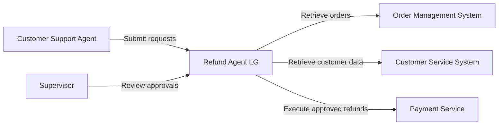
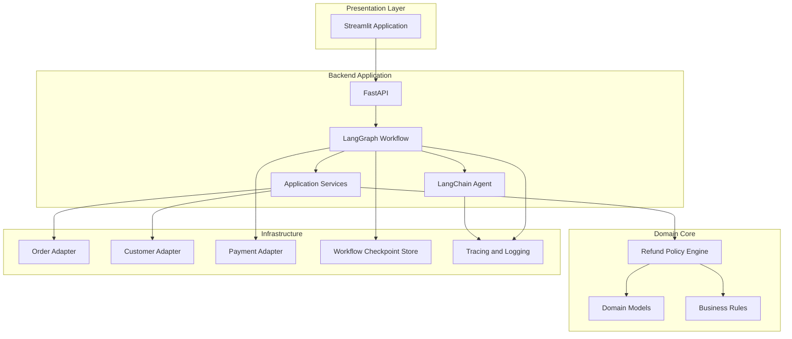
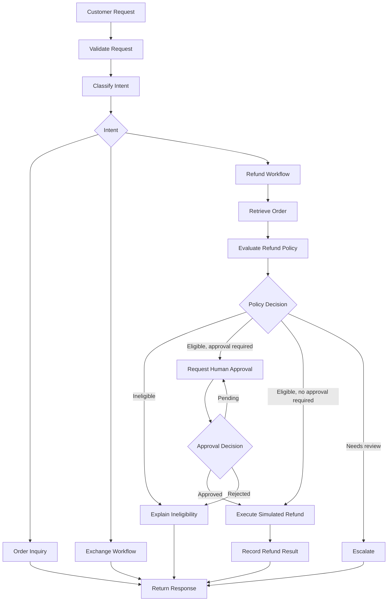
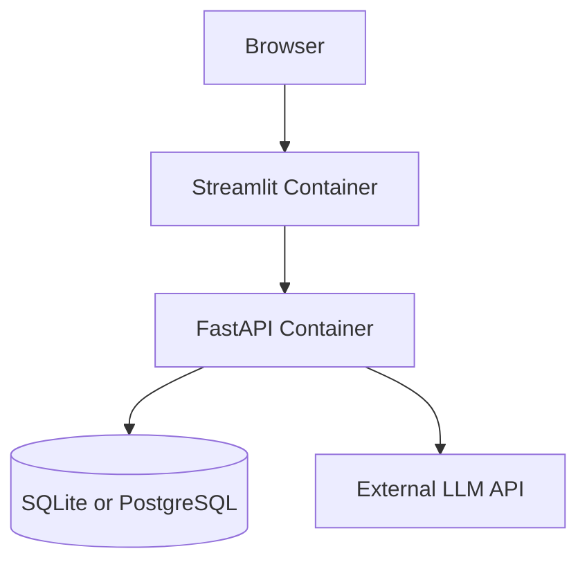

# Refund Agent LG — System Architecture

## 1. Overview

Refund Agent LG is a modular AI-assisted customer support application designed to handle refund requests, exchanges, and order inquiries.

The architecture separates presentation, application orchestration, domain logic, AI capabilities, and external service integrations.

The system uses LangGraph to manage stateful workflows, LangChain for LLM capabilities, FastAPI for backend APIs, and Streamlit for the support-agent interface.

## 2. Architectural Goals

- Enforce deterministic business policies.
- Support stateful workflows and human approval.
- Keep domain logic independent of AI frameworks.
- Isolate external service dependencies.
- Support testability and observability.
- Enable incremental development.
- Provide a portfolio-ready local deployment.

## 3. Architecture Style

The system follows a modular layered architecture with ports-and-adapters principles.

### Layers

1. Presentation Layer
2. API Layer
3. Application and Workflow Layer
4. AI Agent Layer
5. Domain Layer
6. Infrastructure and Integration Layer

The domain layer contains business rules and does not depend on LangChain, LangGraph, FastAPI, or Streamlit.

## 4. System Context



## 5. Container Architecture



## 6. Component Responsibilities

### 6.1 Streamlit Application

Location: `app/`

Responsibilities:

- Provide customer support chat interface.
- Display order and customer information.
- Show refund eligibility and explanations.
- Display approval queue.
- Allow authorized supervisors to approve or reject requests.
- Display workflow status and execution history.
- Present evaluation results.

The Streamlit application communicates with FastAPI over HTTP.

It must not implement refund eligibility rules or directly execute payment operations.

### 6.2 FastAPI Backend

Location: `src/refund_agent/api/`

Responsibilities:

- Expose REST endpoints.
- Validate API requests and responses.
- Authenticate and authorize users.
- Invoke application services and workflows.
- Return workflow status and results.
- Provide OpenAPI documentation.

FastAPI is the application entry point for the UI.

### 6.3 LangGraph Workflow

Location: `src/refund_agent/workflow/`

Responsibilities:

- Define workflow state.
- Execute workflow nodes.
- Control conditional transitions.
- Manage approval interruptions.
- Persist workflow checkpoints.
- Resume interrupted workflows.
- Handle workflow failures.

LangGraph is responsible for orchestration, not for defining business policy.

### 6.4 LangChain Agent

Location: `src/refund_agent/agent/`

Responsibilities:

- Interpret customer requests.
- Classify customer intent.
- Extract structured information.
- Generate policy-grounded explanations.
- Select approved tools when required.
- Produce validated response structures.

The agent must not independently determine financial eligibility or bypass approval requirements.

### 6.5 Domain Layer

Location: `src/refund_agent/domain/`

Responsibilities:

- Define business entities and value objects.
- Represent refund and exchange requests.
- Define domain statuses and decisions.
- Enforce domain invariants.
- Provide framework-independent business logic.

Example domain objects:

- Customer
- Order
- OrderItem
- RefundRequest
- RefundDecision
- RefundTransaction
- ExchangeRequest
- ApprovalDecision

### 6.6 Refund Policy Engine

Location: `src/refund_agent/policies/`

Responsibilities:

- Validate return windows.
- Validate item eligibility.
- Evaluate order status.
- Calculate refundable amounts.
- Enforce refund limits.
- Account for previous refunds.
- Determine escalation requirements.

The policy engine must be deterministic and independently testable.

### 6.7 Tool Layer

Location: `src/refund_agent/tools/`

Responsibilities:

- Expose application capabilities to the agent.
- Validate tool inputs.
- Return structured outputs.
- Enforce tool-level authorization.
- Prevent unsafe or duplicate operations.

Tools call application services or integration adapters rather than accessing infrastructure directly.

### 6.8 Integration Layer

Location: `src/refund_agent/integrations/`

Responsibilities:

- Provide order lookup adapters.
- Provide customer lookup adapters.
- Provide simulated payment operations.
- Translate external service responses into application models.
- Handle timeouts and integration failures.

Initial integrations use synthetic data and simulated services.

### 6.9 Persistence

Responsibilities:

- Persist workflow checkpoints.
- Store approval decisions.
- Store refund execution records.
- Support audit history.
- Enable workflow recovery.

The initial implementation may use SQLite for local persistence, with an adapter boundary for future database replacement.

## 7. Refund Workflow



## 8. LangGraph State Design

The workflow state contains the information required to execute and resume a request.

Initial state fields:

- `request_id`
- `conversation_id`
- `customer_id`
- `intent`
- `order_id`
- `order`
- `refund_request`
- `policy_decision`
- `approval_status`
- `approval_decision`
- `refund_transaction`
- `messages`
- `errors`
- `workflow_status`

State must contain structured application data rather than relying exclusively on conversation history.

Sensitive information must be minimized in persisted state.

## 9. API Design

Initial REST endpoints:

| Method | Endpoint | Purpose |
|---|---|---|
| POST | `/api/v1/requests` | Submit customer request |
| GET | `/api/v1/orders/{order_id}` | Retrieve order details |
| GET | `/api/v1/workflows/{workflow_id}` | Retrieve workflow status |
| GET | `/api/v1/approvals` | List pending approvals |
| POST | `/api/v1/approvals/{approval_id}/decision` | Approve or reject |
| GET | `/api/v1/refunds/{refund_id}` | Retrieve refund status |
| GET | `/health` | Health check |

Approval endpoints require supervisor authorization.

## 10. Streamlit Page Architecture

```text
app/
├── streamlit_app.py
├── pages/
│   ├── 1_Customer_Support.py
│   ├── 2_Order_Details.py
│   ├── 3_Approval_Queue.py
│   ├── 4_Workflow_Trace.py
│   └── 5_Evaluation_Dashboard.py
└── services/
    └── api_client.py
```

### Customer Support

- Enter customer requests.
- View agent responses.
- Inspect refund recommendations.
- Display workflow status.

### Order Details

- Search synthetic orders.
- View items, delivery status, and refund history.

### Approval Queue

- View pending requests.
- Inspect policy decisions.
- Approve or reject requests.

### Workflow Trace

- Display workflow node execution.
- Show tool calls and results.
- Display errors and escalation reasons.

### Evaluation Dashboard

- Display evaluation metrics.
- Compare model and prompt experiments.
- Review failed test cases.

## 11. Security Boundaries

- Authentication occurs at the API boundary.
- Authorization is enforced for sensitive operations.
- Supervisor-only approval actions are protected.
- Payment execution requires an approved workflow state.
- Tool inputs are validated.
- External data is treated as untrusted.
- LLM-generated text cannot authorize financial operations.
- Idempotency controls prevent duplicate refund execution.
- Audit events record significant decisions and actions.

## 12. Failure Handling

| Failure | Expected behavior |
|---|---|
| Order not found | Return a clear not-found result |
| LLM timeout | Retry within limits or return controlled failure |
| Policy evaluation error | Fail closed; do not execute refund |
| Payment service failure | Record failure and preserve workflow state |
| Approval rejection | Terminate execution path |
| Workflow interruption | Persist state and resume later |
| Duplicate execution request | Return existing transaction result |
| Invalid tool arguments | Reject tool call |

## 13. Deployment Architecture

Initial local development:



The first milestone may run Streamlit and FastAPI as separate local processes.

A later Docker Compose setup can include:

- Streamlit container
- Backend container
- Database container

The LLM provider is accessed through an external API.

## 14. Architecture Quality Attributes

| Attribute | Design approach |
|---|---|
| Maintainability | Modular layers and clear boundaries |
| Testability | Framework-independent domain logic |
| Reliability | Checkpoints, retries, controlled failures |
| Security | API authorization and tool safeguards |
| Auditability | Structured events and workflow history |
| Extensibility | Adapter interfaces for integrations |
| Observability | LangSmith tracing and structured logs |
| Reproducibility | Dependency locking and automated tests |

## 15. Architecture Decisions

- LangGraph is used for explicit workflow orchestration.
- LangChain is used for model integration and agent capabilities.
- Refund policies are implemented in deterministic Python.
- FastAPI is the backend interface.
- Streamlit is the demonstration UI.
- Payment execution is simulated in the initial release.
- Domain logic is isolated from AI frameworks.
- Workflow state is persisted to support approval and recovery.
- External integrations use adapter interfaces.

## 16. Related Documents

- `constitution.md`
- `product-requirements.md`
- `domain-model.md`
- `workflow-design.md`
- `api-spec.md`
- `ui-spec.md`
- `security.md`
- `test-strategy.md`
- `build-plan.md`
- `assumptions-and-open-questions.md`
