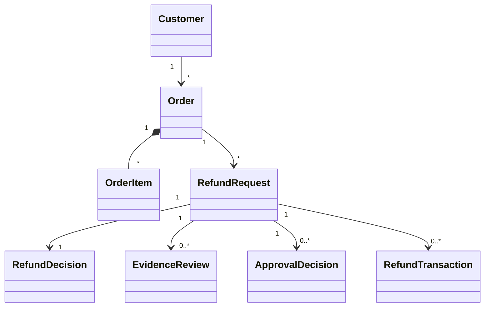

# Refund Agent LG — Domain Model

## 1. Overview

The domain model defines the business entities, value objects, relationships, statuses, and invariants for Refund Agent LG.

The domain layer is independent of LangChain, LangGraph, FastAPI, and Streamlit.

It is responsible for representing business concepts and enforcing fundamental business constraints.

## 2. Domain Design Principles

- Domain-driven design concepts.
- Explicit entities and value objects.
- Decimal arithmetic for financial calculations.
- Enumerations for controlled statuses.
- Deterministic business invariants.
- Framework-independent domain logic.
- Configurable refund policies.

## 3. Core Domain Entities

### 3.1 Customer

Represents a customer using the service.

| Attribute | Type |
|---|---|
| customer_id | UUID |
| name | String |
| email | String |
| tier | CustomerTier |
| created_at | Datetime |

Customer tiers:

- STANDARD
- SILVER
- GOLD
- PLATINUM

### 3.2 Order

Represents a customer purchase.

| Attribute | Type |
|---|---|
| order_id | UUID |
| customer_id | UUID |
| items | List[OrderItem] |
| total_amount | Money |
| order_status | OrderStatus |
| ordered_at | Datetime |
| delivered_at | Optional Datetime |

Order statuses:

- PENDING
- CONFIRMED
- SHIPPED
- DELIVERED
- CANCELLED

### 3.3 OrderItem

Represents an individual item within an order.

| Attribute | Type |
|---|---|
| item_id | UUID |
| product_id | UUID |
| product_name | String |
| quantity | Integer |
| unit_price | Money |
| refundable | Boolean |
| return_window_days | Integer |

### 3.4 RefundRequest

Represents a customer's refund request.

| Attribute | Type |
|---|---|
| refund_id | UUID |
| order_id | UUID |
| customer_id | UUID |
| item_ids | List[UUID] |
| reason | RefundReason |
| requested_amount | Money |
| status | RefundStatus |
| created_at | Datetime |

### 3.5 RefundDecision

Represents the result of deterministic policy evaluation.

| Attribute | Type |
|---|---|
| eligible | Boolean |
| approved_amount | Money |
| decision_reason | String |
| policy_codes | List[String] |
| requires_approval | Boolean |
| requires_evidence | Boolean |
| requires_human_review | Boolean |
| requires_escalation | Boolean |

Possible decision outcomes:

- ELIGIBLE
- INELIGIBLE
- NEEDS_REVIEW

The LLM may explain the decision but cannot modify it.

### 3.6 EvidenceReview

Represents the human review of supporting evidence for damaged-item claims.

| Attribute | Type |
|---|---|
| evidence_review_id | UUID |
| refund_id | UUID |
| evidence_reference | String |
| status | EvidenceReviewStatus |
| reviewer_id | Optional UUID |
| comments | Optional String |
| reviewed_at | Optional Datetime |

Evidence review statuses:

- PENDING
- ACCEPTED
- REJECTED
- INSUFFICIENT

Evidence should be stored securely. The domain model should reference evidence rather than embed image files.

### 3.7 ApprovalDecision

Represents a supervisor's financial approval decision.

| Attribute | Type |
|---|---|
| approval_id | UUID |
| refund_id | UUID |
| reviewer_id | UUID |
| decision | ApprovalStatus |
| comments | Optional String |
| decided_at | Optional Datetime |

Evidence review and financial approval are separate decisions. A damaged-item claim may require evidence review even when its amount does not exceed CAD 100.

### 3.8 RefundTransaction

Represents a refund execution attempt through the payment adapter.

| Attribute | Type |
|---|---|
| transaction_id | UUID |
| refund_id | UUID |
| payment_reference | String |
| amount | Money |
| status | RefundTransactionStatus |
| idempotency_key | String |
| processed_at | Optional Datetime |

## 4. Value Objects

| Value object | Purpose |
|---|---|
| Money | Amount and currency |
| RefundReason | Standardized refund reason |
| RefundDecision | Policy evaluation result |
| ApprovalPolicy | Approval requirements |
| PolicyViolation | Identifies a violated rule |
| EvidenceReference | Reference to supporting evidence |

### Money

Money must use Decimal arithmetic rather than floating-point arithmetic.

```python
from dataclasses import dataclass
from decimal import Decimal


@dataclass(frozen=True)
class Money:
    amount: Decimal
    currency: str = "CAD"

    def __post_init__(self):
        if self.amount < Decimal("0"):
            raise ValueError("Money cannot be negative")

        if len(self.currency) != 3:
            raise ValueError("Invalid currency code")
```

## 5. Domain Enumerations

```python
from enum import StrEnum


class CustomerTier(StrEnum):
    STANDARD = "standard"
    SILVER = "silver"
    GOLD = "gold"
    PLATINUM = "platinum"


class OrderStatus(StrEnum):
    PENDING = "pending"
    CONFIRMED = "confirmed"
    SHIPPED = "shipped"
    DELIVERED = "delivered"
    CANCELLED = "cancelled"


class RefundStatus(StrEnum):
    REQUESTED = "requested"
    UNDER_REVIEW = "under_review"
    APPROVED = "approved"
    REJECTED = "rejected"
    PROCESSING = "processing"
    PROCESSED = "processed"
    FAILED = "failed"


class ApprovalStatus(StrEnum):
    PENDING = "pending"
    APPROVED = "approved"
    REJECTED = "rejected"


class EvidenceReviewStatus(StrEnum):
    PENDING = "pending"
    ACCEPTED = "accepted"
    REJECTED = "rejected"
    INSUFFICIENT = "insufficient"


class RefundTransactionStatus(StrEnum):
    PENDING = "pending"
    PROCESSING = "processing"
    SUCCEEDED = "succeeded"
    FAILED = "failed"


class RefundReason(StrEnum):
    DAMAGED_ITEM = "damaged_item"
    WRONG_ITEM = "wrong_item"
    NOT_AS_DESCRIBED = "not_as_described"
    CUSTOMER_CHANGED_MIND = "customer_changed_mind"
    LATE_DELIVERY = "late_delivery"
```

## 6. Entity Relationships



## 7. Confirmed Business Policies

### POL-001: Return Window

A standard return request must be submitted within 30 calendar days after delivery.

```python
RETURN_WINDOW_DAYS = 30
```

The policy engine must use the delivery timestamp and request timestamp.

Requests outside the return window are ineligible under the standard return policy unless a separately authorized exception applies.

### POL-002: Refund Approval Threshold

Supervisor approval is required when the calculated refund amount exceeds CAD 100.

```python
REFUND_APPROVAL_THRESHOLD = Decimal("100.00")
```

Rules:

- CAD 100.00: No amount-based supervisor approval.
- CAD 100.01: Supervisor approval required.
- CAD 150.00: Supervisor approval required.

This threshold applies to the calculated refund amount, not the original order total.

### POL-003: Damaged Goods Evidence

Damaged-item claims require supporting evidence and human review.

Rules:

- Evidence must be associated with the refund request.
- Missing evidence results in NEEDS_REVIEW.
- Insufficient evidence results in NEEDS_REVIEW.
- Evidence acceptance must be recorded.
- Human review is mandatory regardless of refund amount.
- Evidence acceptance does not automatically authorize payment.

### POL-004: Item Eligibility

Items marked non-refundable cannot receive a standard item return refund.

### POL-005: Previous Refunds

Previously processed refunds must reduce the remaining refundable balance.

### POL-006: Cancelled Orders

Cancelled orders must follow a separate cancellation/refund policy rather than the standard delivered-item return policy.

## 8. Business Invariants

| ID | Invariant |
|---|---|
| INV-01 | Refund amounts cannot be negative. |
| INV-02 | Refund cannot exceed remaining refundable balance. |
| INV-03 | Standard returns must satisfy the 30-day window. |
| INV-04 | Non-refundable items cannot receive standard refunds. |
| INV-05 | Refunds above CAD 100 require supervisor approval. |
| INV-06 | Damaged goods require supporting evidence and human review. |
| INV-07 | Evidence acceptance does not replace financial approval. |
| INV-08 | Refund execution cannot happen before all required reviews and approvals. |
| INV-09 | Duplicate execution must be prevented using idempotency. |
| INV-10 | Previous successful refunds must reduce the refundable balance. |
| INV-11 | The order must belong to the requesting customer. |
| INV-12 | Rejected requests cannot proceed to execution. |
| INV-13 | Currency must be consistent during refund calculations. |
| INV-14 | An existing successful transaction must not be executed again. |

## 9. Refund Decision Model

Example eligible refund:

```json
{
  "outcome": "eligible",
  "eligible": true,
  "approved_amount": "75.00",
  "currency": "CAD",
  "requires_approval": false,
  "requires_evidence": false,
  "requires_human_review": false,
  "requires_escalation": false,
  "policy_codes": ["POL-001"],
  "decision_reason": "The item is within the 30-day return window."
}
```

Example damaged-item claim:

```json
{
  "outcome": "needs_review",
  "eligible": false,
  "approved_amount": "0.00",
  "currency": "CAD",
  "requires_approval": false,
  "requires_evidence": true,
  "requires_human_review": true,
  "requires_escalation": true,
  "policy_codes": ["POL-003"],
  "decision_reason": "Supporting evidence and human review are required."
}
```

The second example represents a request awaiting review, not a final rejection.

## 10. Refund Execution Conditions

A refund may proceed to execution only when:

1. The request passes applicable eligibility rules.
2. Required supporting evidence has been accepted.
3. Required human review has been completed.
4. Supervisor approval has been recorded when the refund exceeds CAD 100.
5. The refund amount has been validated against the remaining refundable balance.
6. The execution request passes idempotency checks.

The payment adapter must enforce these conditions through trusted application services, not through LLM-generated decisions.

## 11. Domain Package Structure

```text
src/refund_agent/domain/
├── __init__.py
├── entities/
│   ├── customer.py
│   ├── order.py
│   ├── order_item.py
│   ├── refund_request.py
│   ├── evidence_review.py
│   ├── approval.py
│   └── refund_transaction.py
├── value_objects/
│   ├── money.py
│   ├── refund_decision.py
│   ├── approval_policy.py
│   └── policy_violation.py
├── enums/
│   ├── customer_tier.py
│   ├── order_status.py
│   ├── refund_status.py
│   ├── approval_status.py
│   └── evidence_review_status.py
└── exceptions.py
```

## 12. Domain Independence

The domain layer must not import:

- langchain
- langgraph
- fastapi
- streamlit
- External LLM provider SDKs

Domain behavior must be independently testable using standard Python and pytest.

## 13. Confirmed Policy Configuration

| Setting | Value |
|---|---|
| Return window | 30 calendar days |
| Refund approval threshold | CAD 100 |
| Approval condition | Amount strictly greater than CAD 100 |
| Damaged goods evidence | Required |
| Damaged goods review | Human review required |
| Payment execution | Simulated |
| Policy enforcement | Deterministic Python |

## 14. Related Documents

- constitution.md
- product-requirements.md
- architecture.md
- workflow-design.md
- security.md
- test-strategy.md
- assumptions-and-open-questions.md
- build-plan.md
