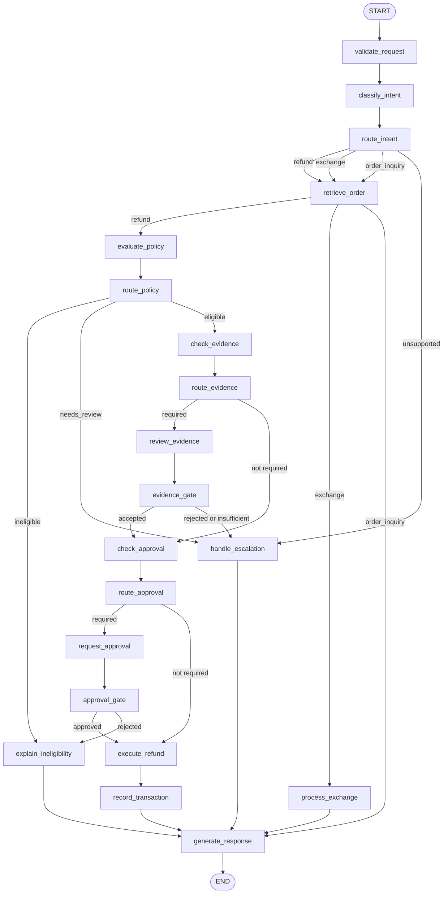
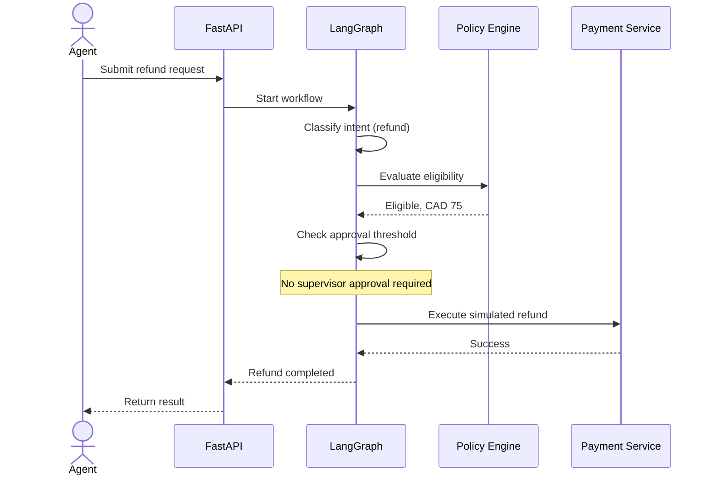
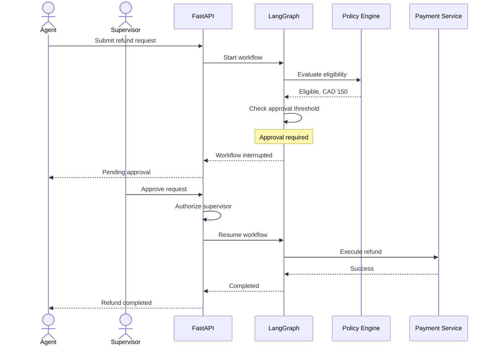
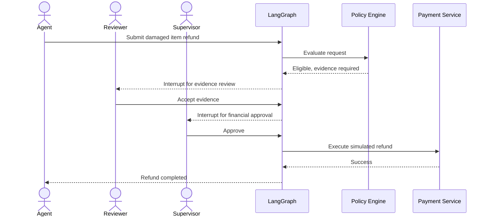

# Refund Agent LG — Workflow Design

## 1. Workflow Architecture

The workflow supports three primary intents:

- Refund Request
- Exchange
- Order Inquiry

The workflow is designed as an explicit state machine before any LangGraph code is written.

It uses a graph-based orchestration model with:

- Explicit nodes with a single responsibility.
- Conditional edges for routing.
- Checkpoints for persistence and recovery.
- Human approval interruptions.

### Critical Controls

1. Refund eligibility is determined by the deterministic policy engine.
2. Damaged-item evidence review and financial approval are separate gates.
3. Refund execution is possible only after all applicable gates have passed.

## 2. Workflow State Machine



## 3. Workflow Nodes

Each node has one clearly defined responsibility.

| Node | Responsibility | Output |
|---|---|---|
| `validate_request` | Validate incoming request | Validated request |
| `classify_intent` | Identify customer intent | Intent |
| `route_intent` | Select workflow | Route |
| `retrieve_order` | Retrieve order details | Order |
| `evaluate_policy` | Apply deterministic policies | Refund decision |
| `check_evidence` | Determine evidence requirements | Evidence requirement |
| `review_evidence` | Obtain human evidence decision | Evidence status |
| `check_approval` | Determine financial approval requirement | Approval requirement |
| `request_approval` | Interrupt for supervisor decision | Approval decision |
| `execute_refund` | Execute simulated refund | Transaction |
| `record_transaction` | Persist transaction result | Transaction record |
| `explain_ineligibility` | Explain a rejection or failed gate | Explanation |
| `process_exchange` | Handle exchange request | Exchange result |
| `generate_response` | Generate customer-facing explanation | Response |
| `handle_escalation` | Route unresolved cases | Escalation result |

## 4. LangGraph State Design

The graph uses a shared typed state.

The initial implementation uses `TypedDict` for LangGraph state and Pydantic models for validated business objects.

### State Structure

```python
from typing import Any, TypedDict


class RefundAgentState(TypedDict, total=False):
    # Request
    request_id: str
    conversation_id: str
    customer_id: str
    user_message: str

    # Intent
    intent: str
    intent_confidence: float

    # Order
    order_id: str
    order: dict[str, Any]

    # Refund
    refund_id: str
    refund_request: dict[str, Any]
    policy_decision: dict[str, Any]

    # Evidence
    evidence_reference: str
    evidence_status: str

    # Approval
    approval_required: bool
    approval_status: str
    approval_decision: dict[str, Any]

    # Execution
    refund_transaction: dict[str, Any]

    # Response
    response: str
    workflow_status: str
    messages: list[dict[str, Any]]
    errors: list[str]
```

**Design rule:** The graph state carries workflow information. It does not replace the domain entities or become the authoritative financial ledger.

## 5. Conditional Routing

The workflow uses conditional edges to determine the next node.

### Intent Routing

```python
def route_intent(state: RefundAgentState) -> str:
    intent = state["intent"]
    routes = {
        "refund_request": "refund",
        "exchange": "exchange",
        "order_inquiry": "order_inquiry",
    }
    return routes.get(intent, "unsupported")
```

### Policy Routing

```python
def route_policy(state: RefundAgentState) -> str:
    decision = state["policy_decision"]
    outcome = decision["outcome"]

    if outcome == "ineligible":
        return "reject"
    if outcome == "needs_review":
        return "escalate"
    return "check_evidence"
```

### Evidence Routing

```python
def route_evidence(state: RefundAgentState) -> str:
    decision = state["policy_decision"]

    if decision["requires_evidence"]:
        return "human_evidence_review"
    return "check_approval"
```

### Approval Routing

```python
def route_approval(state: RefundAgentState) -> str:
    decision = state["policy_decision"]

    if decision["requires_approval"]:
        return "human_approval"
    return "execute_refund"
```

The actual implementation will validate the decision using typed domain objects rather than trusting arbitrary dictionaries.

## 6. Human-in-the-Loop Architecture

There are two independent human review gates.

### Gate A — Evidence Review

Required for damaged goods.

- Review supporting evidence.
- Accept or reject evidence.
- Record reviewer identity.
- Return to the workflow.

### Gate B — Financial Approval

Required above CAD 100.

- Review refund amount.
- Review policy decision.
- Approve or reject the request.
- Record supervisor identity.

A request may require both gates.

| Request | Evidence review | Supervisor approval |
|---|---|---|
| CAD 50, normal return | No | No |
| CAD 150, normal return | No | Yes |
| CAD 50, damaged item | Yes | No |
| CAD 150, damaged item | Yes | Yes |

### LangGraph Interruption

The workflow uses LangGraph's `interrupt()` mechanism to pause execution while awaiting human input.

Conceptual evidence review gate:

```python
from langgraph.types import interrupt


def review_evidence(state: RefundAgentState):
    decision = interrupt(
        {
            "type": "evidence_review",
            "refund_id": state["refund_id"],
            "evidence_reference": state["evidence_reference"],
        }
    )

    return {
        "evidence_status": decision["status"],
    }
```

Conceptual financial approval gate:

```python
from langgraph.types import interrupt


def request_approval(state: RefundAgentState):
    decision = interrupt(
        {
            "type": "refund_approval",
            "refund_id": state["refund_id"],
            "amount": state["policy_decision"]["approved_amount"],
            "reason": state["policy_decision"]["decision_reason"],
        }
    )

    return {
        "approval_status": decision["status"],
        "approval_decision": decision,
    }
```

The graph uses a checkpointer to persist state.

When the supervisor submits a decision, the backend resumes the graph using `Command(resume=...)` and the same workflow thread identifier.

**Important:** The API must independently authenticate the supervisor and authorize the decision before resuming the workflow. An LLM must never submit an approval decision.

## 7. Workflow Sequences

### Scenario A — Normal Refund, CAD 75



### Scenario B — Refund of CAD 150



### Scenario C — Damaged Item, CAD 150



## 8. Workflow Persistence and Recovery

The workflow uses LangGraph checkpointing.

Initial local configuration:

- SQLite-based checkpoint persistence.
- A unique `thread_id` for each workflow.
- Checkpoints after workflow execution steps.
- Resume interrupted workflows using the original thread.
- Persist approval decisions separately as business records.

The following information must survive application restarts:

- Current workflow state.
- Current execution step.
- Pending approval information.
- Evidence review status.
- Previous decisions.
- Refund execution status.

A LangGraph checkpoint is not a replacement for transactional persistence of refund records.

### Dual Persistence Model

Two separate persistence concepts are maintained:

| Persistence | Responsibility |
|---|---|
| LangGraph checkpointer | Workflow state and execution recovery |
| Application database | Orders, refund requests, evidence reviews, approvals, transactions, audit records |

This prevents workflow checkpoints from becoming the source of truth for financial operations.

## 9. Error Handling

| Failure | Handling |
|---|---|
| Invalid request | Reject before graph execution |
| Unknown intent | Route to unsupported request |
| Order not found | Return controlled error |
| LLM timeout | Retry within configured limits |
| Policy engine failure | Stop execution |
| Missing evidence | Pause for evidence submission |
| Evidence rejected | Reject or escalate |
| Approval rejected | Stop refund execution |
| Payment failure | Record failed transaction |
| Duplicate execution | Return existing transaction |
| Application restart | Resume from checkpoint |

Financial execution must use an idempotency key and a persistent transaction record.

## 10. Workflow Statuses

| Status | Meaning |
|---|---|
| `RECEIVED` | Request received |
| `PROCESSING` | Workflow executing |
| `WAITING_FOR_EVIDENCE` | Evidence submission or review required |
| `WAITING_FOR_APPROVAL` | Supervisor decision required |
| `ESCALATED` | Requires additional review |
| `COMPLETED` | Workflow successfully completed |
| `REJECTED` | Request rejected |
| `FAILED` | Workflow execution failed |

These are workflow statuses. Refund request statuses and payment transaction statuses remain separate domain concepts.

## 11. LangGraph Package Structure

```text
src/refund_agent/workflow/
├── __init__.py
├── state.py
├── graph.py
├── nodes/
│   ├── validate.py
│   ├── classify.py
│   ├── order.py
│   ├── policy.py
│   ├── evidence.py
│   ├── approval.py
│   ├── refund.py
│   ├── exchange.py
│   └── response.py
├── routing/
│   ├── intent_router.py
│   └── policy_router.py
├── persistence/
│   └── checkpointer.py
└── exceptions.py
```

## 12. Testing Strategy

### Unit Tests

- Intent routing.
- Policy routing.
- Approval threshold.
- Evidence requirements.
- State validation.

### Workflow Tests

- Eligible refund.
- Ineligible refund.
- Refund below approval threshold.
- Refund above approval threshold.
- Damaged item without evidence.
- Damaged item with accepted evidence.
- Damaged item with rejected evidence.
- Both evidence review and financial approval.
- Payment failure.
- Workflow interruption and recovery.

### Critical Safety Tests

- No refund without required approval.
- No refund without required evidence review.
- No duplicate execution.
- No execution after rejection.
- No execution after policy evaluation failure.
- No supervisor approval from an unauthorized user.

## 13. Architecture Decisions

1. LangGraph manages the complete business workflow.
2. LangChain handles LLM interactions.
3. The policy engine is deterministic.
4. Evidence review and financial approval are separate interrupts.
5. Workflow checkpoints support interruption and recovery.
6. The payment service is simulated.
7. Financial execution uses idempotency controls.
8. API authorization is enforced outside the LLM.
9. Domain models remain independent of workflow state.
10. Workflow checkpoints and business records use separate persistence.

## 14. Related Documents

- `constitution.md`
- `product-requirements.md`
- `architecture.md`
- `domain-model.md`
- `api-spec.md`
- `ui-spec.md`
- `security.md`
- `test-strategy.md`
- `definition-of-done.md`
- `build-plan.md`
